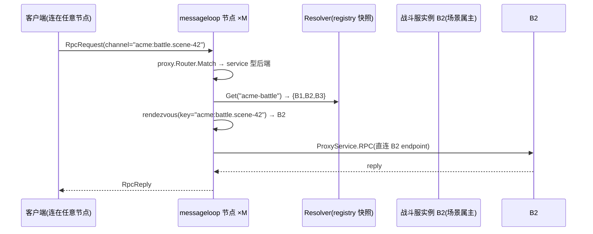

# 提案:RPC 一致性 hash 路由与服务注册发现

| | |
| --- | --- |
| 状态 | **Accepted(2026-10-15 评审拍板,见 §10)** |
| 日期 | 2026-10-15 |
| 来源 | 内部提案草稿(游戏战斗服场景) |
| 确认后动作 | ✅ 设计文档已出:[docs/design/2026-10-15-rpc-consistent-hash-routing.md](../design/2026-10-15-rpc-consistent-hash-routing.md);排期 v1.1(2026-11-16 启动) |

---

## 1. 问题(使用场景)

游戏战斗服是**内存计算**服务:同一场对局(场景/房间)的全部状态在单个进程内存中,进程内再分发到同一个 actor。因此:

- 同一场景的所有用户请求(RPC),无论发起者连到哪个 messageloop 节点,都必须路由到**同一个战斗服进程实例**;
- 战斗服多实例水平扩缩容时,路由关系要随实例集合变化自动收敛;
- 战斗服实例宕机后,其上场景的路由要自动漂移到幸存实例(场景状态恢复是战斗服自己的责任,平台只负责路由)。

这要求 messageloop 集群具备:**按 key 的一致性 hash RPC 路由** + 支撑它的**服务注册发现**。

## 2. 现状事实(调研结论)

### 2.1 RPC 当前路径:静态 glob 路由,完全不感知后端拓扑

客户端 RPC 的完整路径(调研核实,文件:行号基于当前 main):

```
Client → transport → session.HandleMessage(internal/session/client.go:265)
       → handleRPC(client.go:972)→ namespace 预检 → rt.ProxyRPC(client.go:1016)
       → Node.ProxyRPC(internal/runtime/node.go:778)
       → FindProxy(node.go:751)= proxy.Router.Match(proxy/router.go:75)
       → 静态单实例 endpoint 的 GRPCProxy(proxy/grpc.go:72)/ HTTPProxy(proxy/http.go:124)
```

- 路由表是启动时从 `config.Proxy` 建立的**静态配置**(`SetupProxy`,`node.go:722`);channel 与 method 均为 glob 模式,首个命中即返回。
- **后端(如战斗服)在配置里只有一个 endpoint**。多实例后端今天只能靠外部 LB 兜,而外部 LB 不知道「同场景须同实例」,会把一场对局的请求打散。
- RPC 是同步请求/应答(`server.rpc_timeout`,默认 30s),天然适配确定性路由——请求落在哪个节点,就从哪个节点直接出洞到目标后端,不需要回源到"别的节点"。

### 2.2 集群拓扑:Redis 中介、节点不直连、节点租约无地址

- 多节点协作全部经 Redis:数据面 Pub/Sub + Stream,控制面会话租约 + 命令总线(`pkg/redisbroker/cluster_command_bus.go`,支持按 `(NodeID, IncarnationID)` 定向 + HMAC 验签 + 去重)。
- 节点间**没有任何直连**;`ClusterNodeLease`(`internal/cluster/state.go:19`)只有 ID 与世代,**不含网络地址**——现有集群组件无法直接支撑"按 key 拨到某节点"。

### 2.3 空白与既有架构裁决

- 全仓**没有**任何一致性 hash / hash ring / routing key / sticky routing 实现(grep 零命中);`shard` 一词仅指进程内锁/队列分片(如 `internal/session/hub.go:156` 的 FNV 取模),与跨节点路由无关。
- `docs/v2/kernel-architecture.md` 的既有裁决与本提案的关系:
  - 「不在 Go 里再造 actor 运行时」(:50)——**相容**:actor 语义(单激活、场景状态机)留在战斗服;messageloop 只做无状态路由。
  - 「服务网格粘滞当所有权」为 Non-Goal(:46)——**相容且须守住边界**:本提案的 hash 只做**放置(placement)**,不做所有权;场景状态所有权始终在战斗服实例内存里,messageloop 不持有、不迁移、不代管。
  - 「偷 Orleans 单激活 + Directory,不偷 actor 运行时」(:735-741)——§4 的 B 方案(键目录 sticky 模式)正是这个已裁决模式向后端路由的自然延伸。

### 2.4 lynx registry 能力核实(对草稿的一处修正)

草稿说「lynx-go/x 实现了 registry」——经核实,registry **不在 `lynx-go/x`**(v0.1.0,仅 convert/encoding/log 工具),而在 **`lynx-go/lynx` 主仓库的 contrib 子模块**(独立 Go module + 独立 tag):

| 模块 | 内容 | 首次发布 |
| --- | --- | --- |
| `contrib/registry` | 核心契约:`Registry{Register/Deregister/Heartbeat/Close}`、`Discovery{GetService/Watch}`、`Instance{Name,ID,Version,Endpoints[{Protocol,Address}],Status,Tags,Meta,Weight}`、`Registrar`(生命周期/心跳/排水注销)、`Resolver`(客户端缓存 + watch + 轮询兜底 + stale 上限) | lynx v1.4.0(2026-08-20) |
| `contrib/registry-redis` | Redis 后端:实例 key `SET EX heartbeat_ttl` 即租约,Pub/Sub 推变更 + 15s 快照轮询兜底;依赖 `redis.UniversalClient`(**可复用 messageloop 现有 go-redis 连接**) | lynx v1.18.0(2026-10-15,最新版) |
| `contrib/consul` | Consul 后端:TTL/http/grpc 健康检查、`DeregisterCriticalServiceAfter`、blocking query watch | lynx v1.4.0 |

关键缺口:**lynx 的 `Picker` 只有 `Random`/`RoundRobin` 两个实现,没有一致性 hash picker**,且 `Pick(instances)` 签名不携带路由 key。一致性 hash 选实例需要本仓自研(一个纯函数级的 rendezvous 实现,成本低)。

本仓现状:root module `require github.com/lynx-go/lynx v1.17.0`(服务端已用 lynx 应用框架)+ `lynx/contrib/zap v1.17.0`。升级到 v1.18.0 的破坏性变更(客户端 URI scheme `registry://`→`discovery://`、排水注销改走 `lynx.Drainer`)目前都未使用,**升级窗口正当其时**。

## 3. 提案(方案概览)

> 细节(键编码、hash 函数、连接池、配置 schema 全量字段)留给确认后的设计文档;本节只定骨架。

一句话:**proxy 层新增「服务发现」型后端,按路由 key 对后端实例做一致性 hash(Rendezvous)选实例;静态单实例 `endpoint` 配置原样保留。**

### 3.1 组件分解

1. **依赖升级**:`lynx-go/lynx` v1.17.0 → v1.18.0(含 contrib/zap 对齐);新增 require `contrib/registry`、`contrib/registry-redis`、(可选)`contrib/consul`,各锁最新 tag。
2. **注册发现接线**:
   - 新增 `registry` 配置段(backend: redis|consul;redis 复用 `broker.redis` 连接或独立连接,键前缀如 `ml2:registry/`)。
   - messageloop 节点侧只做**发现(Discovery/Resolver)**;注册(Registrar)由**后端服务(战斗服)**自己完成——它是最知道自身生死与 readiness 的一方。
3. **proxy 新后端形态**(`config.Proxy` 扩展,向后兼容):

   ```yaml
   proxy:
     - name: battle
       service: acme-battle        # 新:发现式后端,替代静态 endpoint
       routes:                       # 既有 glob 语义不变
         - channel: "acme:battle.*"
           method: "*"
       routing:
         key: channel              # channel | metadata:<字段名>;默认 channel
       grpc:
         insecure: true
   ```

4. **路由键**:`RpcRequest` 已带 `metadata` 字段(`protocol/client/v2/service.proto:142`,proxy 侧 `protocol/proxy/v2/proxy.proto:36` 同)——**客户端线协议零改动**。默认 key = channel(游戏场景下 channel 天然含场景 ID,如 `acme:battle.scene-42`);可配 `metadata:<field>` 支持显式路由键。
5. **选实例**:自研 key-aware Rendezvous(HRW)hash。选 Rendezvous 而非一致性 hash ring:战斗服实例数典型 <100,Rendezvous 无需虚拟节点、实现最小、均匀性够。输入 = Resolver 的实例快照 + 路由 key;**所有 messageloop 节点对同一快照算出同一映射,零协调**。
6. **连接管理**:per-instance gRPC `ClientConn` 缓存,随 Resolver 成员变化增删;实例摘除时排空。
7. **失败语义**:**fail-fast,不向备选实例漂移**。目标实例不可达即按既有 `PROXY_ERROR`/超时路径返回——对内存态场景,把请求重试到另一实例等于制造场景分裂,比失败更糟。扩缩容瞬间的映射抖动见 §6-Q2。
8. **可观测性**:每 service 的实例数 gauge、路由决策计数、`NO_PROXY`(无实例)计数、Resolver stale 指标;成员变化(加入/摘除)打 Info 日志。

### 3.2 请求时序



pub/sub 数据面不受影响:发往场景频道的 Publication 仍走 broker(Redis 广播 + 订阅兴趣);本提案只改 RPC 出洞路径。

## 4. 备选方案与取舍

| 方案 | 做法 | 取舍 |
| --- | --- | --- |
| **A. 纯一致性 hash(本提案 MVP)** | 无状态:同快照下所有节点同映射 | 零协调、实现最小;缺点:实例集合一变(扩容/缩容/宕机)约 1/N 的 key 立即换属主,**运行中对局会被切走**(状态在内存,等于丢失) |
| B. 键租约目录(sticky,二期可选) | 首触 `SET NX scene→instance` + TTL 续约,路由查目录;hash 只做冷启动放置 | 扩容不迁移运行中场景,只有实例死亡才漂移——与 v2 kernel 已裁决的「单激活 + Directory」哲学同构;代价:每场景一次 Redis 写 + 续约,以及 hash 层之外多一个组件。**建议作为 A 落地后的可选模式(`routing.strategy: sticky`),不是首期** |
| C. messageloop 节点间转发 | hash 选节点,节点间 NodeRPC 转发 | 否决:节点租约无地址字段、引入节点直连新通道、多一跳延迟;RPC 应答路径本就允许任意节点直连后端,无此必要 |
| D. 客户端直连战斗服 | 路由信息下发客户端 | 否决:破坏传输/鉴权/namespace 统一边界,客户端协议膨胀 |

## 5. 与既有架构的相容性小结

- **不改客户端线协议、不改 proto**;静态 `endpoint` 代理与 `api_auth` 指派行为不变(单实例是 service 模式的退化情形)。
- messageloop 保持消息平台定位:路由是无状态纯函数(f(key, snapshot) → instance),不引入场景状态、不引入 actor 运行时、不把服务网格当所有权——分别对应 kernel-architecture 三条 Non-Goal 的守界。
- 集群既有 Redis 直接复用(redis 后端),不新增必选基础设施;consul 仅对已有 Consul 的部署是增量选项。
- 模块边界:registry 接线落在 root module(服务端);`shared/`、`sdks/go` 不引入 registry 依赖(见 Q5)。

## 6. 开放问题(评审拍板)

| # | 问题 | 建议 |
| --- | --- | --- |
| Q0 | **路由目标确认**:一致性 hash 的目标是 proxy 后端(战斗服)的多实例,不是 messageloop 节点自身(草稿未明说,按 §1 场景推断为前者) | 按前者推进 |
| Q1 | 路由键默认值:channel vs 显式 metadata | 默认 channel(场景 ID 天然在频道名里),metadata 作覆盖 |
| Q2 | 扩缩容时运行中对局的漂移责任:平台只管换映射、场景状态丢失/恢复由战斗服负责(快照重建或对局重开) | 平台只管路由,写进文档作为契约;需要不丢的场景等 B 方案(sticky) |
| Q3 | 首期后端:redis-only 还是 redis+consul 都上 | MVP redis-only(零新基础设施);consul 因 lynx 契约统一,作为紧随其后的增量 |
| Q4 | HTTP 型后端是否首期支持一致性 hash | 首期 gRPC(战斗服主路径);HTTP 仅 endpoint 选择层复用,列二期 |
| Q5 | `sdks/go` 是否内置 Registrar helper 供后端服务注册 | 不内置,保持 SDK 依赖最小;后端服务用 lynx(或任意语言写 registry 键)自行注册,示例文档给 Go 范例 |
| Q6 | messageloop 节点自身是否也注册进 registry | 不注册(现有节点租约已够用);留作未来 SDK 侧节点发现的口子,不入本期 |
| Q7 | 排期位置:与 v1.0(2026-11-14 发版门禁)的关系 | 列 **v1.1** 候选,不插队 v1.0 七缺口;设计文档可与 P9/P10 并行先行 |

## 7. 风险

| 风险 | 缓解 |
| --- | --- |
| lynx v1.17→v1.18 升级引入未知回归 | 升级独立成 PR,跑全量测试;破坏性变更(URI scheme/Drainer)经查未使用 |
| 各节点 Resolver 快照短暂不一致(成员变化窗口)→ 同一 key 短暂路由到新旧两个属主 | MVP 接受(窗口 <1s,与既有静态后端重启的语义同级);B 方案(sticky)根治;写进文档 |
| 注册表投毒(能写 Redis/Consul 即能注册假实例) | 与既有集群组件同一信任边界(Redis 密码/Consul token);`Filter.Tags` 支持环境隔离;HMAC 不适用(注册方是外部服务),文档明示边界 |
| redis 后端无被动健康检查(活而不健的实例不摘除) | lynx 已知取舍;实例进程崩溃即 TTL 过期摘除;「活而不健」由 RPC 超时路径兜底,文档明示 |

## 8. 粗粒度工作量与 PR 切分(供排期)

约 **4 人周**(1 名熟手),设计先行可与 v1.0 收尾并行:

| PR | 内容 | 估 |
| --- | --- | --- |
| PR-A | lynx 升级 v1.18.0 + contrib 引入 + `registry` 配置段与 Resolver 装配(无路由行为变化) | 0.5 周 |
| PR-B | proxy `service` 型后端 + rendezvous 选实例 + per-instance conn 管理(gRPC) | 1.5 周 |
| PR-C | metadata 路由键 + 指标/日志 + redis 集成 e2e(双节点路由一致性、实例下线摘除) | 1 周 |
| PR-D(可选) | consul 后端 + HTTP 后端 + sticky 键目录模式 | 后续排 |

## 9. 评审确认清单

确认以下各项后,本提案转 Accepted,随即出设计文档并排期:

1. Q0 路由目标 = 后端服务多实例(§6)。
2. Q1–Q7 的拍板(或接受表中建议值)。
3. 方案 A(纯一致性 hash)作为 MVP、方案 B 列二期的路线。
4. 排期位置(v1.1 候选)。

## 10. 评审记录(2026-10-15)

| 项 | 拍板 |
| --- | --- |
| Q0 | 确认:一致性 hash 选择的是**战斗服 proxy 后端**的多实例,不是 messageloop 节点 |
| Q2 | 接受一期(纯一致性 hash)/ 二期(sticky 键目录)安排 |
| Q7 | 列 **v1.1** |
| Q1、Q3–Q6 | 按表中建议值通过(路由键默认 channel;MVP redis-only;HTTP 后端二期;`sdks/go` 不内置 Registrar;节点不自注册) |
| 补充 | **协同修改 lynx-go/lynx 使其 Picker 支持路由 key**:一致性 hash 选实例上移为 lynx `contrib/registry` 的 `KeyedPicker` 能力,本仓协同提上游 PR;规格见设计文档 §3 |
| 评审补充(2026-10-15) | RPC 实例选择策略**配置化**:`consistent_hash`(默认)/ `round_robin` / `random`,service 型后端同时覆盖有状态(定向)与无状态(轮转/随机)负载;详见设计文档 §4.3 |
